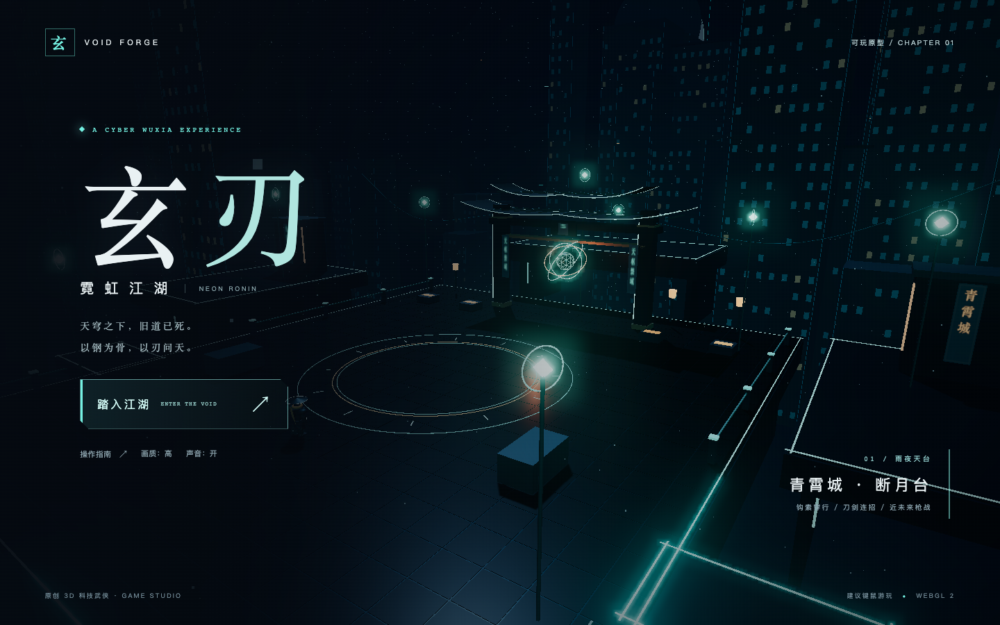

# 玄刃 · 霓虹江湖 / Neon Wuxia

原创科技武侠第三人称 3D 动作游戏。以青霄城雨夜天台为舞台，融合钩索穿行、刀剑连招、格挡反击与手枪战斗。

这是可玩原型，采用程序化风格化美术；并非完整商用 3A 游戏。



## 试玩

下载本仓库中的 **玄刃-即点即玩.html**，在电脑 Chrome / Edge 中打开即可游玩，无需安装依赖，运行时不请求外部素材。

开发版本需要 Node.js 22.12+：

```bash
npm ci
npm run dev
```

Mac 用户也可双击 `启动游戏.command`。更多说明见 [试玩说明](试玩说明.md)。

## 游戏内容

- 流光剑、断雨刀、寂鸣枪，三段连招、耗内息重击、换弹与射线命中。
- 二段跳、瞬步闪避、精准格挡反击、真实物理钩索。
- 近战 / 远程守卫、三波战斗与天枢首领战，共 21 名敌人。
- 雨夜悬空城、东方屋檐、霓虹装置、刀光和粒子。
- 暂停、画质 / 声音切换、通关 / 失败、重新挑战和本机最高分。

| 按键 | 操作 |
|---|---|
| WASD / 鼠标 | 移动 / 视角 |
| 空格 | 跳跃 / 二段跳 |
| 左键 / Q | 攻击 / 重击 |
| 右键 / E | 刀剑格挡，手枪右键瞄准 |
| Shift / F | 闪避 / 钩索 |
| 1 / 2 / 3 | 剑 / 刀 / 手枪 |
| R / Tab | 换弹 / 锁定 |
| ESC 或 P / H | 暂停 / 操作指南 |

## 开发

技术栈：TypeScript、Vite、Three.js、Rapier 3D、Web Audio。菜单和 HUD 使用 DOM。

```text
src/simulation/      规则、战斗、AI 与波次
src/physics/         Rapier 角色控制和碰撞
src/render/          场景、角色、动画和特效
src/input.ts         键鼠输入
src/audio.ts         实时音效
src/ui.ts            HUD、菜单与结算
src/main.ts          循环、镜头与集成
```

```bash
npm run build
npm run preview
```

角色与场景为原创程序化几何；Three.js、Rapier 及其他依赖的授权以各依赖包的 LICENSE 为准。仓库暂未授予项目源码的开源许可。
